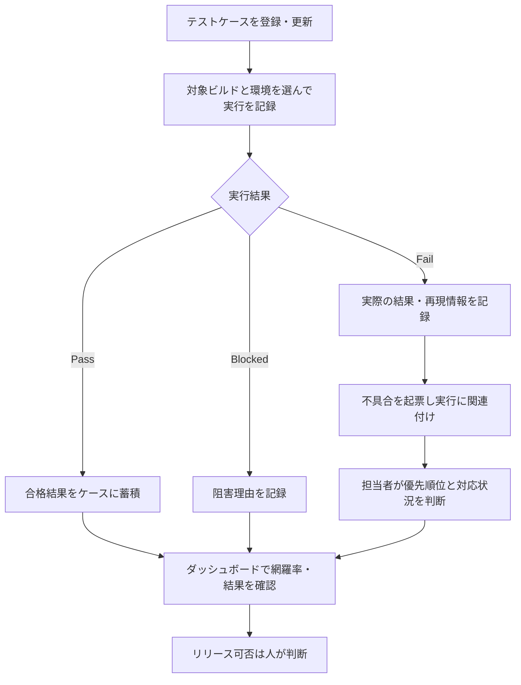

# 業務要件: Code Apps テスト管理

## 根拠と確度

### 確認できた事実

- ワークスペース名は `CodeAppsTest20261028`。
- 業務資料は配置されていない。
- ユーザーは開発環境へのデプロイとテストを希望している。接続先は Developer 環境として検証済み。

### 仮説

- 開発者／QA 担当者が、Code Apps のテスト項目、ビルドごとの実行結果、発見した不具合をまとめて追跡したい。
- メール・表計算などに結果が分散すると、ケースとビルド間の追跡や未解決不具合の把握が難しくなる可能性がある。
- 個人情報を含むテストデータや本番データは初期版へ登録しない。

## 目的と測定

テストケースから実行結果・不具合までを一貫して追跡し、リリース判断に必要な未実施・失敗・未解決の状況を一画面で確認できるようにする。現状値がないため改善率は約束しない。導入後に、実行記録の作成から不具合の追跡までにかかる時間と、未解決項目の見落とし件数を測定する。

## To-Be 業務フロー

## 業務上の境界

- AI によるリリース可否の自動決定は行わない。
- 初期版ではログ本文を外部 AI サービスへ送信しない。
- 既存のセキュリティロール変更、ユーザーへのアプリ共有、本番環境へのデプロイは対象外。
