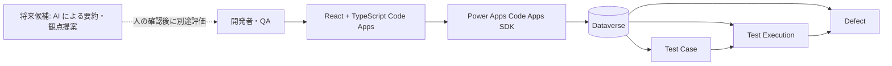

# 設計要件: Code Apps テスト管理

## 推奨構成

React + TypeScript の Power Apps Code Apps を UI とし、Dataverse をケース・実行・不具合の唯一の業務データストアとする。初期版では AI、Power Automate、Azure リソースを追加しない。データ操作は Code Apps の Dataverse SDK / generated service を利用し、シークレットをブラウザーへ含めない。

## テンプレート選定

- **採用**: `.github/skills/code-apps/templates/generic-base`。新規 Code Apps の scaffold 取得元として指定されており、React/Vite、テーマ、共通 UI、predeploy 検査を含む。
- **参照のみ**: `.github/skills/code-apps/samples/geek-quality`。一覧・詳細・集計の UI パターンは参考になるが、製造業検査の業務モデルであり、scaffold 元にはしない。
- `samples/geek-*` は業務固有の型・ページ・サービスが混入するため scaffold には使用しない。
- 既存にソフトウェア QA 用テンプレートは見つからなかった。generic-base 上に対象業務のページ・型・Dataverse service を実装する。

## 実装済み構成

- `app/` は generic-base を元にした React + TypeScript + Vite の Code App。
- Dataverse の3テーブルを業務データストアとし、Test Case → Test Execution → Defect の lookup を保持する。Defect は Test Case も直接参照する。
- `app/scripts/setup_dataverse.py` は Solution、テーブル、列、lookup を冪等に用意し、実際の EntitySetName をアプリ設定へ保存する。
- Code Apps の生成済み Dataverse service を `app/src/lib/dataverse-service.ts` から利用し、QA 固有の入出力変換と CRUD を `app/src/lib/qa-service.ts` に集約する。
- 画面は Dashboard、Test Cases、Executions、Defects。各画面で読み込み／空／エラー状態を扱い、書き込み失敗を通知する。

## セキュリティ・運用境界

- Developer 環境と確認済みだが、環境 URL / ID / tenant 情報は無視対象 `.env` に限定する。
- `.env` のシークレット、認証トークン、実データはソース・ビルド成果物・文書へ含めない。
- Dataverse の既存 Publisher を再利用した専用 Solution、テーブル、接続参照を Developer 環境に作成済み。ロール変更と追加共有はしていない。
- AI 提案は将来候補。導入時は入力データの扱い、利用可能モデル、ライセンス・費用、評価基準を先に確認する。AI は説明可能な候補提示に限定し、実行結果やリリースを自動確定しない。

## 検証・運用

- `npm run lint`、`npm run build`、`npm run predeploy` を実行する。
- Developer 環境でケース、実行、不具合の関連付けを合成データで確認し、検証後に削除する。
- `.env` と認証キャッシュはローカル環境に限定し、コミット・文書・ブラウザー成果物へ含めない。
- 初期版では AI、Power Automate、Azure リソースを追加しない。
